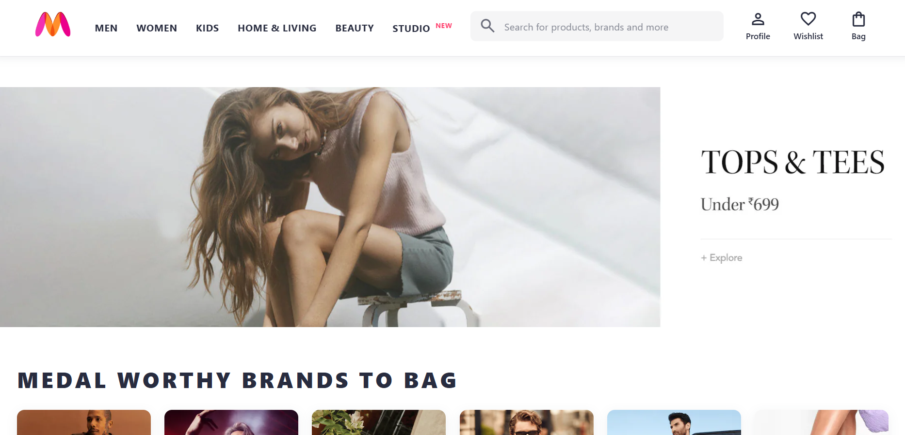
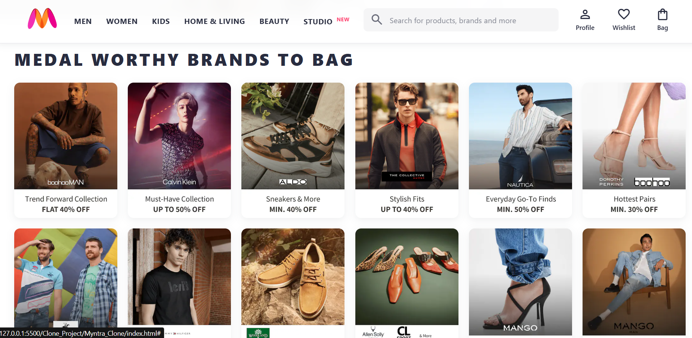
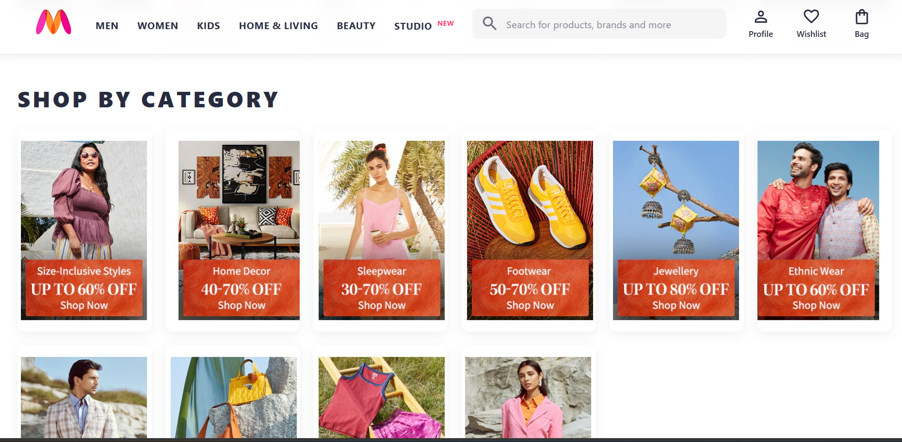

# 🛍️ Myntra Clone

A responsive fashion shopping homepage inspired by Myntra. Built with **HTML, CSS, and JavaScript**.

<p align="center">
  
</p>

## ✨ Features

- Responsive layout for desktop, tablet, and mobile
- Fashion navigation bar and product search
- Promotional brand offers and shopping categories
- Hover effects on images and navigation links
- Wishlist and shopping bag interactions

## 🖥️ Screenshots

Click a screenshot to open the full-size image.

<table>
  <tr>
    <td align="center">
      <a href="screenshots/myntra-homepage-banner.png">
        
      </a>
      <br>
      <strong>Homepage Banner</strong>
    </td>
    <td align="center">
      <a href="screenshots/myntra-brand-offers.png">
        
      </a>
      <br>
      <strong>Brand Offers</strong>
    </td>
  </tr>
  <tr>
    <td align="center" colspan="2">
      <a href="screenshots/myntra-shop-by-category.png">
        
      </a>
      <br>
      <strong>Shop by Category</strong>
    </td>
  </tr>
</table>

## 🧰 Built With

- HTML5
- CSS3
- JavaScript

## 📁 Project Structure

```text
Myntra_Clone/
├── images/
├── screenshots/
│   ├── myntra-homepage-banner.png
│   ├── myntra-brand-offers.png
│   └── myntra-shop-by-category.png
├── index.html
├── script.js
├── style.css
└── README.md
```

## 🚀 Run the Project

1. Clone or download this repository.
2. Open the `Myntra_Clone` folder in Visual Studio Code.
3. Open `index.html` in your browser.

For automatic browser refresh, install the **Live Server** extension in VS Code, right-click `index.html`, and choose **Open with Live Server**.

## 📝 Customize

- Edit page content in `index.html`.
- Change colors and responsive styles in `style.css`.
- Update product data and interactions in `script.js`.
- Add or replace project images in the `images/` folder.

## 📌 Note

This is a learning project inspired by Myntra. It is not affiliated with or endorsed by Myntra.
