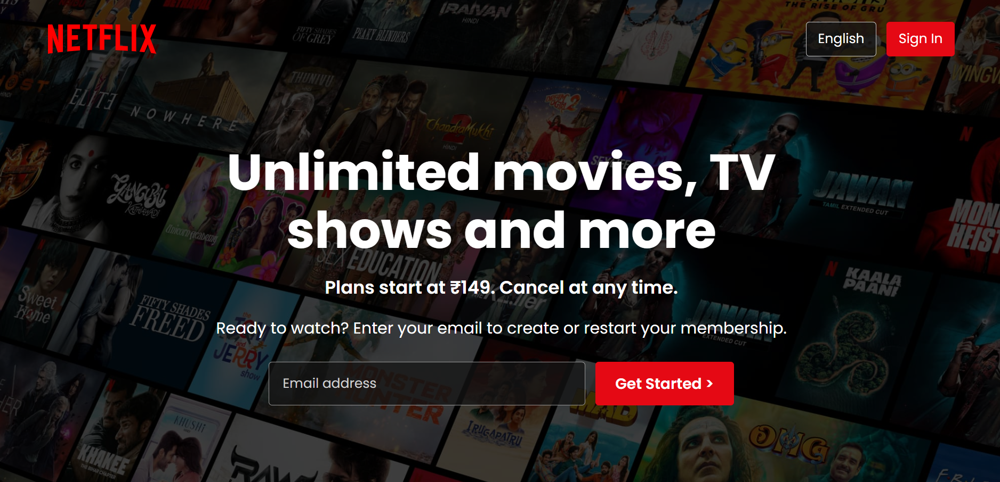

# Netflix Clone

A Netflix-inspired front-end homepage made for learning and practice. This project uses HTML, CSS, and JavaScript to recreate the look and feel of a streaming service landing page.

> This is an independent educational project. It is not affiliated with Netflix and does not provide real streaming, sign-in, or membership services.

## Homepage Preview



## Features

- Netflix-inspired homepage design
- Hero section with email field and call-to-action button
- Feature sections for TV, downloads, watching on different devices, and kids profiles
- FAQ section
- Responsive styling for desktop and mobile screens
- Front-end demo interactions with JavaScript

## Built With

- **HTML5** — page structure
- **CSS3** — styling and responsive layout
- **JavaScript** — browser-side interactions

## Project Structure

```text
Netflix_Clone/
├── assets/                       # Images and other project assets
├── screenshots/
│   └── netflix-homepage-desktop.png
├── favicon.ico                   # Browser tab icon
├── index.html                    # Main webpage
├── script.js                     # Front-end interactions
├── style.css                     # Page styles and responsive rules
└── README.md                     # Project documentation
```

## Run the Project

1. Download or clone this repository.
2. Open the `Netflix_Clone` folder.
3. Open `index.html` in a web browser.

You can also open the folder in Visual Studio Code and use the Live Server extension.


## Learning Goals

This project helped me practice semantic HTML, CSS layouts, responsive design, and basic JavaScript interactions.

## Author

**Akash Kheto**  
GitHub: [Akash-Kheto](https://github.com/Akash-Kheto)
