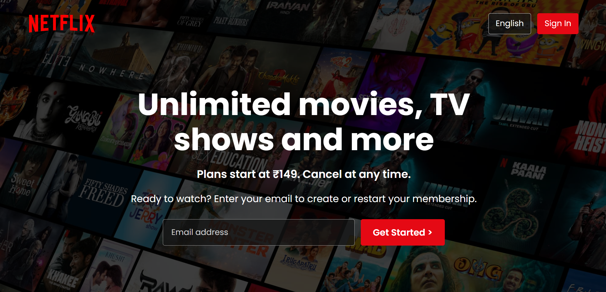
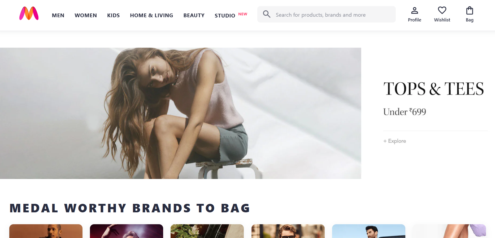
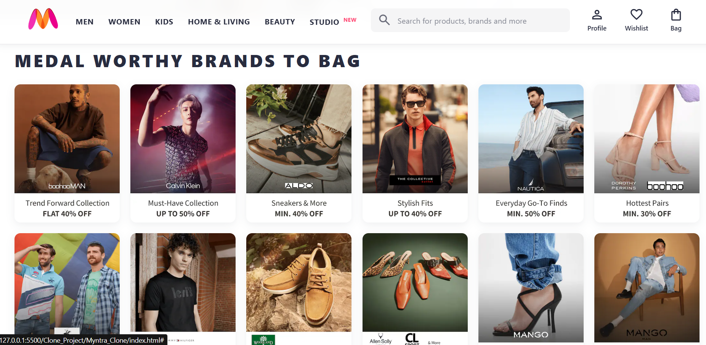
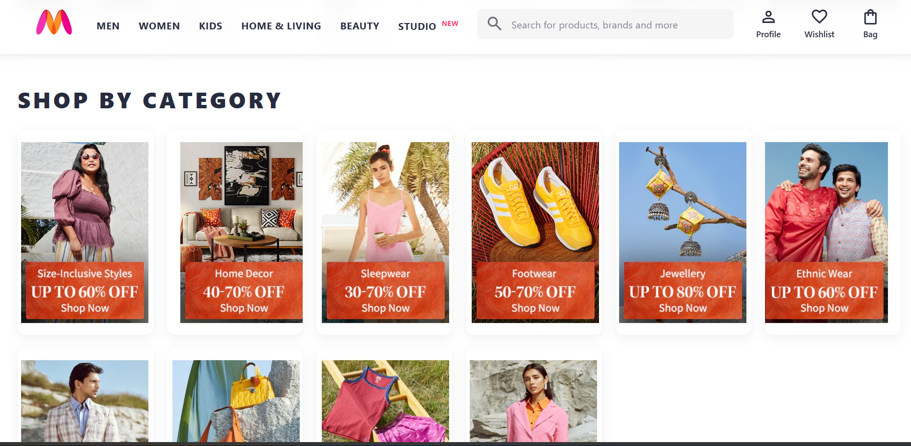

# 🎨 Front-End Clone Projects

Welcome! This repository is my **front-end practice playground**. I recreate familiar website layouts to learn and improve my HTML, CSS, and JavaScript skills.

> [!NOTE]
> These are independent educational projects. They are not affiliated with the original companies and do not offer their real products or services.

## 🧭 Explore the Projects

<details open>
<summary><strong>▶ Netflix Clone</strong> — streaming homepage</summary>

A Netflix-inspired homepage built with **HTML, CSS, and JavaScript**.

- 📂 **Folder:** [`Netflix_Clone/`](Netflix_Clone/)
- 🧰 **Technologies:** HTML · CSS · JavaScript
- 🚀 **Open the project:** [`Netflix_Clone/index.html`](Netflix_Clone/index.html)

**Preview:** Click the screenshot to view the full-size image.

<a href="Netflix_Clone/screenshots/netflix-homepage-desktop.png">
  
</a>

</details>

<details open>
<summary><strong>▶ Myntra Clone</strong> — fashion shopping homepage</summary>

A Myntra-inspired fashion shopping homepage built with **HTML, CSS, and JavaScript**.

- 📂 **Folder:** [`Myntra_Clone/`](Myntra_Clone/)
- 🧰 **Technologies:** HTML · CSS · JavaScript
- 🚀 **Open the project:** [`Myntra_Clone/index.html`](Myntra_Clone/index.html)

**Previews:** Click any image to view it full size.

| Homepage Banner | Brand Offers |
|---|---|
| [](Myntra_Clone/screenshots/myntra-homepage-banner.png) | [](Myntra_Clone/screenshots/myntra-brand-offers.png) |

**Shop by Category**

[](Myntra_Clone/screenshots/myntra-shop-by-category.png)

</details>

## 🕹️ Run a Project

1. Open the project folder you want to explore.
2. Open its `index.html` file in a browser.
3. Or open the folder in Visual Studio Code and launch it with the **Live Server** extension.

## 🗂️ Repository Map

<details>
<summary><strong>Click to show the folder structure</strong></summary>

```text
frontend-clone-project/
├── Myntra_Clone/
│   ├── images/
│   ├── screenshots/
│   │   ├── myntra-homepage-banner.png
│   │   ├── myntra-brand-offers.png
│   │   └── myntra-shop-by-category.png
│   ├── index.html
│   ├── script.js
│   ├── style.css
│   └── README.md
├── Netflix_Clone/
│   ├── assets/
│   ├── screenshots/
│   │   └── netflix-homepage-desktop.png
│   ├── favicon.ico
│   ├── index.html
│   ├── script.js
│   ├── style.css
│   └── README.md
└── README.md
```

</details>

## 🌱 What’s Next?

More front-end clone projects will be added as I learn. Each project will have its own source files, assets, screenshots, and project README.

## 👤 Author

**Akash Kheto**  
[🐙 Visit my GitHub profile](https://github.com/Akash-Kheto)
